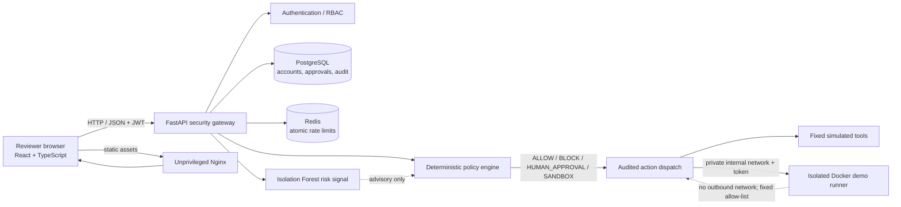

# AgentShield

AgentShield is a FastAPI runtime security gateway for AI-agent actions. It uses deterministic, deny-by-default policy rules, registered agent identities, reviewer approvals, Redis rate limiting, database audit records, and an isolated Docker sandbox service for a small allow-listed demo action.

**Scope:** the agent and tool actions are simulations; they do not call customer systems or change external data. The sandbox service is a real Docker-container boundary for its fixed demo action. It is not a general-purpose code sandbox. Machine-learning anomaly scores are risk signals only and never override deterministic policy decisions.

## Project layout

- `backend/main.py`: FastAPI application and backward-compatible HTTP routes.
- `backend/security/`: policy-as-code, Redis rate limit, audit persistence, and anomaly scoring.
- `backend/auth/`: bcrypt password handling, JWT issuance/verification, and role checks.
- `backend/database/`: SQLAlchemy models, schema setup, and account/agent provisioning.
- `backend/tools/`: policy-rechecking simulated executor and Docker sandbox client.
- `backend/policies/agentshield.yaml`: deterministic policy rules. The file is JSON syntax, which is a valid YAML 1.2 subset, so the backend does not need a YAML parser dependency.
- `sandbox/`: fixed allow-listed runner and isolated Docker service.
- `dashboard/`: React + TypeScript security console.
- `backend/benchmarks/`: repeatable adversarial and legitimate policy benchmark.

## Problem statement and research motivation

Autonomous agents can request actions through tools and APIs, making it important to enforce identity, authorization, policy, human oversight, and traceability at the point of execution. AgentShield explores a runtime gateway that evaluates each simulated action deterministically before it can reach a registered tool. The project is an educational research prototype; its simulations and benchmark do not establish production security or protection against every prompt-injection technique.

## Architecture



In Compose, PostgreSQL and Redis have persistent/private service networking and no published host ports. Only the API and dashboard are bound to loopback by default. The API does not mount the Docker socket. The sandbox is attached only to an internal network shared with the API and can execute only its fixed demo action.

## Features

- Short-lived JWT authentication and bcrypt password hashes.
- Reviewer/administrator authorization for approvals, audit records, monitoring, and policy views; agent-only action endpoints.
- Deny-by-default policy decisions with `ALLOW`, `BLOCK`, `HUMAN_APPROVAL`, and `SANDBOX` outcomes.
- Approval lifecycle protections and audit records for decisions.
- Redis-backed atomic rate limiting and PostgreSQL persistence.
- Advisory Isolation Forest anomaly scores; deterministic policy remains authoritative.
- Simulated tools and a narrowly allow-listed, network-isolated Docker demo runner.
- React/TypeScript security dashboard with live API data and backend-derived security state.
- Persistent reviewer dashboard preferences, date-bounded event summaries, and event trends.
- Administrator-only agent registration and suspension/reactivation; passwords are hashed and never returned.
- Versioned policy publishing with conflict/stale-write validation, a dry-run endpoint, and change history.
- Persisted benchmark run history and synthetic held-out anomaly-model evaluation metrics.
- Reproducible 100-attack / 60-legitimate-action benchmark and automated tests.

## Technology stack

| Area | Technologies |
|---|---|
| Backend | Python 3.12, FastAPI, Pydantic, SQLAlchemy |
| Authentication | JWT (HS256), bcrypt, role-based authorization |
| Storage | PostgreSQL, Redis |
| Risk signal | scikit-learn Isolation Forest |
| Frontend | React 18, TypeScript, Vite, Three.js |
| Deployment | Docker Compose, Nginx, GitHub Actions |

## Quick start with Docker Compose

1. Install Docker Desktop with the Compose plugin. Copy and edit the deployment environment file:

   ```powershell
   Copy-Item .env.example .env
   notepad .env
   ```

   Replace the placeholders with independent random values for `AGENTSHIELD_SECRET_KEY`, `AGENTSHIELD_SANDBOX_TOKEN`, `POSTGRES_PASSWORD`, and `REDIS_PASSWORD`. For URL-safe database and Redis values, use 32 random bytes in hexadecimal. Example generator (run separately for each secret):

   ```powershell
   python -c "import secrets; print(secrets.token_hex(32))"
   ```

   Configure a reviewer username and password if you want non-interactive provisioning. Passwords must be 12–72 UTF-8 bytes. Never commit `.env`.
2. Start services:

   ```powershell
   docker compose up --build -d
   ```

   The API waits for PostgreSQL, Redis, and the isolated sandbox health checks. It runs idempotent schema creation and versioned migrations before serving. The Compose file binds the dashboard and API to `127.0.0.1`; PostgreSQL and Redis are not published to the host.
3. Initialize the demo policy data and provision accounts once:

   ```powershell
   docker compose exec api python -m database.seed
   docker compose exec api python -m database.create_reviewer
   docker compose exec api python -m database.create_agent
   ```

   `database.seed` is for a fresh database and is not run automatically; do not rerun it on a populated database. `create_reviewer` prompts securely if reviewer credentials are absent from `.env`. `AGENTSHIELD_AGENT_USERNAME` must match an agent registered by the seed step (for example, `customer_support_bot`) before running agent provisioning.
4. Open the dashboard at `http://localhost:5173`; API docs are at `http://localhost:8000/docs`. Check readiness with:

   ```powershell
   Invoke-RestMethod http://127.0.0.1:8000/health
   docker compose ps
   ```

   Stop the stack with `docker compose down`; persistent data stays in named volumes. To remove database/cache data as well, use `docker compose down -v` only when you intentionally want to delete that data.

The compose stack requires Docker Engine and Compose. The API container never mounts the Docker socket. It communicates with a narrow sandbox HTTP service over an internal Docker network. That container has a read-only filesystem, no Linux capabilities, no-new-privileges, resource limits, an unprivileged user, and no outbound network. It only accepts the fixed `demo.preview` action with a shared high-entropy token.

The dashboard image is a static production build served by unprivileged Nginx. `VITE_API_URL` is embedded during the image build; set it in `.env` before rebuilding if the API is hosted at a different browser-reachable URL.

## Local backend

Use Python 3.12+. Configuration is loaded from `backend/.env` by absolute path, independent of the current directory. The repository does not contain a PostgreSQL password or reviewer credentials.

```powershell
if (-not (Test-Path backend\.env)) { Copy-Item backend\.env.example backend\.env }
notepad backend\.env
```

For local development on Windows, set `AGENTSHIELD_ENVIRONMENT=development` and `AGENTSHIELD_DATABASE_MODE=sqlite-dev`. This explicitly selects the SQLite file `backend/data/agentshield-dev.sqlite3`; it does not switch automatically and never changes or deletes the PostgreSQL database. The data directory is ignored by Git. To use PostgreSQL locally, set `AGENTSHIELD_DATABASE_MODE=postgres` and `DATABASE_URL` to `postgresql+psycopg2://<your-user>:<your-url-encoded-password>@localhost:5432/agentshield`. Use credentials you control and URL-encode reserved characters. PostgreSQL remains the production/deployment database; SQLite is rejected when `AGENTSHIELD_ENVIRONMENT=production`.

Set a unique random value of at least 32 bytes for `AGENTSHIELD_SECRET_KEY`. For local Redis without authentication, use `REDIS_URL=redis://localhost:6379/0`; use authenticated Redis in deployed environments. Redis remains required for rate limiting, and authentication fails closed if it is unavailable.

Generate a signing secret locally with `python -c "import secrets; print(secrets.token_hex(32))"` and paste the output into `backend/.env`; do not reuse it as a database or Redis password.

Install dependencies and start the backend from the workspace root:

```powershell
python -m venv .venv
.\.venv\Scripts\Activate.ps1
pip install -r backend\requirements-dev.txt
Set-Location backend
python -m database.create_tables
python -m database.create_reviewer  # one-time; prompts for your own username/password
python -m uvicorn main:app --reload
```

With `sqlite-dev`, app startup creates missing tables idempotently and applies additive audit-chain columns to older databases; it does not drop existing data. The reviewer command is a one-time step; choose your own username and password when prompted. The password is not printed or stored in plaintext. You can instead configure `AGENTSHIELD_REVIEWER_USERNAME` and `AGENTSHIELD_REVIEWER_PASSWORD`. There is no public account-registration endpoint; account creation is an administrative provisioning operation.

For PostgreSQL, `python -m database.create_tables` creates missing tables and applies the versioned SQL migrations once using a migration ledger and advisory lock. `create_all` is not treated as an update mechanism for existing tables. The migration does not drop or reset existing data.

Check `http://127.0.0.1:8000/health` for readiness. It checks the configured database schema and Redis, without returning connection details or secrets. Database and Redis failures are logged by error type, not credentials. Redis must be running for login and rate limiting. Sandbox service is only needed for sandbox decisions; it fails closed when unavailable. The test suite uses isolated SQLite and mocked sandbox dispatch, so PostgreSQL, Redis, and Docker are not required to collect or run unit tests.

For sandbox actions, build/run `sandbox/Dockerfile` with the same `AGENTSHIELD_SANDBOX_TOKEN`, or configure `AGENTSHIELD_SANDBOX_URL` to a separately isolated sandbox service. When unavailable, sandbox actions fail closed (503); the API does not claim that a simulation is isolated.

The login endpoint returns short-lived JWTs. Register a reviewer via `database.create_reviewer` and an agent account via `database.create_agent` after registering the agent. Reviewer endpoints require `reviewer` or `security_admin`; `/check-action` and `/agents/simulate` require an active `agent` role. All simulated action dispatch rechecks the YAML policy in the tool layer.

## Local security dashboard

Start the dashboard in a separate PowerShell terminal. Use the `localhost` URL so it matches the default backend CORS origin:

```powershell
Set-Location dashboard
npm install
npm run dev
```

Open `http://localhost:5173` and sign in with a configured reviewer or security administrator account. The console streams persisted security events to authorized reviewers over WebSocket and retains periodic polling as a fallback. Overview metrics and event trends come from bounded database queries; benchmark runs, policy versions, and user presentation preferences are persisted. If using a different frontend origin or API host, set `VITE_API_URL` for the dashboard and add the exact frontend origin to `AGENTSHIELD_CORS_ORIGINS` in `backend/.env`.

The dashboard API address is configurable as `VITE_API_URL` (preferred); `VITE_API_BASE` remains supported for existing setups. For local development, optionally copy `dashboard/.env.example` to `dashboard/.env.local`. The default when no variable is set is `http://127.0.0.1:8000`. Restart Vite after changing the value.

The login request times out with a visible error instead of remaining in a loading state. Database connectivity or schema errors return `503`, distinct from invalid credentials (`401`) and network/CORS failures. Local development uses the exact Vite origins `http://localhost:5173` and `http://127.0.0.1:5173` when no CORS list is configured; production has no implicit origins and requires `AGENTSHIELD_CORS_ORIGINS`. If PostgreSQL is reachable but rejects its configured credentials, explicitly select local SQLite development mode or correct `DATABASE_URL`; no database or reviewer credentials are supplied by the project.

## API endpoints

- `POST /auth/login`, `GET /auth/me`
- `GET /health` — unauthenticated database and Redis readiness check.
- `POST /check-action` — authenticated agent action authorization and simulated tool dispatch.
- `POST /agents/simulate` — submit up to 20 simulated action/tool calls; every call re-enters `/check-action`.
- `GET /approvals`, `GET /approvals/history`, `POST /approvals/decision` — reviewer-only approval queue, history, and decisions.
- `GET /agents` — reviewer-only registered agent status and recent activity.
- `POST /agents`, `PATCH /agents/{agent_name}/status` — security-admin-only registration and suspension/reactivation. Registration requires an initial password; the API stores only its password hash.
- `POST /security/events/ingest` — registered agents submit a bounded, agent-reported event; the gateway re-evaluates the associated action against policy, records it, and does not execute it. Obtain an agent JWT from `/auth/login` first. Event categories are claims from the submitting agent, not independently verified observations.
- `WS /security/stream` — reviewer-only live stream. Offer `agentshield.events.v1` and `agentshield.jwt.<access-token>` as WebSocket subprotocols; the server selects only the non-secret protocol.
- `GET /audit-logs`, `GET /audit-logs/integrity`, `GET /security/summary?hours=24` — reviewer-only audit, chain verification, event/agent/severity counts, and event trends (`hours` is 1–720).
- `GET /security/policies`, `GET /security/policies/history`, `POST /security/policies/dry-run` — reviewer policy view/history and security-admin-only dry-run (no execution).
- `POST /security/policies` — security-admin-only versioned policy publication; requires the currently observed `expected_version`, validates rule conflicts, and creates an audit record.
- `GET /settings/preferences`, `PUT /settings/preferences` — authenticated per-user presentation settings: motion, compact density, polling behavior/interval, in-app notifications, critical-only filtering, and opt-in browser notifications. These do not modify security policy or authentication settings.
- `GET /security/anomaly/evaluation` — reviewer-only synthetic held-out evaluation of advisory Isolation Forest signals.
- `POST /security/benchmark`, `GET /security/benchmark/runs`, `GET /security/benchmark/runs/{run_id}` — reviewer-only benchmark execution and persistent run history.
- `GET /docs`, `GET /openapi.json` — generated API reference.

## Existing database upgrade

Back up an existing PostgreSQL database before deployment. The versioned migration creates unique indexes; before upgrading a database created by an older version, review and resolve duplicate permission, policy, or pending-approval rows (the preflight queries are included at the top of `backend/database/migrations/001_security_hardening.sql`). Compose starts the API with `python -m database.create_tables`, which creates missing tables and applies migrations once using a migration ledger and advisory lock. The migration does not drop data. For manual deployments, run the same module before starting Uvicorn. Do not run the example `database.seed` command on an existing populated database.

## Security model

- Authentication uses password verification and short-lived JWTs. Reviewer data, approval routes, audit data, monitoring, and policy views require reviewer/security-admin roles; agent action routes require an active agent.
- Every action is checked against deterministic, deny-by-default policy before tool dispatch. Approval decisions are reviewer-authorized and execution is rechecked. The Isolation Forest output is advisory only.
- CORS accepts only explicitly configured origins. Production startup requires a strong JWT key, PostgreSQL mode, an explicit origin list, Redis, and a high-entropy sandbox token.
- Simulated tools do not call customer systems or perform external operations. The isolated runner accepts only a fixed demonstration action; it is not a general-purpose code sandbox.
- The Compose sandbox has no external network, no host port, no Docker socket, read-only root filesystem, a non-root identity, dropped capabilities, and resource limits. Do not loosen these controls or mount host paths.
- Audit entries include a SHA-256 hash chain that detects record changes. The chain is stored in the same database and is not an immutable/WORM or externally anchored record; production compliance deployments should forward it to a separately secured append-only system.
- Event reports arrive only through AgentShield-mediated action requests and the authenticated event-ingestion API; AgentShield does not automatically monitor external agent processes. The current WebSocket fan-out is process-local and is intended for the single API worker used by the provided Compose setup.

## Benchmark methodology

The controlled benchmark runs 100 attack scenarios across ten categories and 60 legitimate-action scenarios against the real `main.check_action` gateway, including JWT identity lookup, role checks, deterministic YAML policy evaluation, and action routing. Scenario data is deterministic. A fresh in-memory SQLite database is seeded with synthetic identities for each run. Redis rate-limit decisions are represented by a local counter enforcing the limit returned by the real policy engine; tool and sandbox dispatch are mocked and cannot contact external systems. Anomaly scoring is disabled for this benchmark because it is advisory only and does not participate in authorization.

The simulated unprotected baseline assumes every attack request dispatches because it has no authentication or security gates. In protected results, only an `ALLOW` outcome counts as a successful attack. `BLOCK` counts as detected; approval and sandbox outcomes prevent normal dispatch but are not classified as detections. Legitimate acceptance includes `ALLOW`, `SANDBOX`, and the intended human-approval workflow. Metrics are computed from the observed scenario run; baseline is comparative, not an actual unprotected agent. Latency varies by host. Results do not prove security against real LLM prompt injection, production data, live Redis concurrency, or external tools.

The CLI writes timestamped JSON and CSV reports to `backend/attack_benchmark/reports` (ignored by Git). Run `python -m attack_benchmark.cli` from `backend`, or use the reviewer-only `POST /security/benchmark` endpoint to return a report without writing files.

## Tests and verification

Run backend tests (including isolated lifecycle integration tests), dashboard
component tests/build, the browser E2E workflow, benchmark, and Docker validation:

```powershell
python -m pytest -v
Set-Location dashboard
npm ci
npm test
npm run build
npx playwright install chromium
npm run test:e2e
Set-Location ..
python backend\benchmarks\run_benchmark.py
docker compose config --quiet
docker compose build
```

Lifecycle integration tests use unique temporary SQLite databases and exercise
registration, login, allow/block policy decisions, reviewer approvals,
duplicate/replayed and concurrent approval decisions, audit persistence and
integrity, anomaly scoring, and CORS preflight. Redis rate-limit calls are
replaced with deterministic test doubles; these tests never touch a developer
database or execute real tools. The browser test starts a separate API process
using an in-memory SQLite database, exercises the lifecycle through real HTTP
endpoints, then verifies that the React dashboard displays the persisted
decisions. Its rate limiter is also a test-only double, so local results do not
establish live Redis/PostgreSQL availability or production behavior.

Playwright's browser must be installed once with `npx playwright install
chromium`. GitHub Actions installs Chromium and runs the browser workflow.
Optional live PostgreSQL/Redis tests are guarded by
`AGENTSHIELD_RUN_INTEGRATION_TESTS=1`; enable them only with dedicated
`AGENTSHIELD_TEST_DATABASE_URL` and `AGENTSHIELD_TEST_REDIS_URL` test services.
Never point them at production. Docker validation/build requires Docker Desktop
and Compose.

Latest local verification on Windows: backend **65 passed, 2 skipped**; dashboard **11 passed**; Python compilation and the TypeScript/Vite production build passed. The browser E2E flow is implemented and CI installs Chromium, but could not be executed locally because the Playwright browser binary is unavailable (the local browser download failed with a Windows file-access error). The isolated E2E API and dashboard started successfully and an authenticated action returned `ALLOW` with a persisted audit event. Docker Engine/CLI is not installed, so Docker validation/build and live PostgreSQL/Redis tests were not run locally. Vite reports the lazily loaded shield scene bundle exceeds its 500 kB advisory threshold.

## Screenshots

Screenshots are not included yet. Add reviewed, redacted dashboard images under `docs/screenshots/` and link them here before publishing. Do not include real account names, tokens, customer data, or production audit details.

## Limitations and future enhancements

- Actions and external integrations are simulations; benchmark outcomes are not evidence of production attack prevention.
- The Docker runner is limited to one fixed demo operation and must not be used to execute arbitrary user-supplied code.
- Isolation Forest scoring requires at least 20 recent successful audit samples and uses observed action categories, per-agent tool/action/resource frequency, recent request volume, and prior block rate; it remains an advisory model, not a calibrated production classifier.
- Audit-chain verification detects modifications within the stored chain but cannot detect a coordinated rewrite by an attacker who can rewrite the database and recompute the entire chain. Compose is a single-host deployment baseline rather than a highly available production architecture.
- Dashboard editing supports JSON policy documents (valid YAML 1.2 subset in the policy file format); the dry-run evaluates the currently active version, not an unsaved editor draft. Agent status is active/inactive; a separate soft-delete/archive workflow is not implemented. Presentation preferences persist per account; security-sensitive settings are intentionally not editable in the dashboard.
- The anomaly evaluation uses reproducible synthetic scenario labels and is not a calibrated production classifier. Its metrics should not be interpreted as real-world effectiveness.
- Future work could add managed secret delivery, TLS/reverse-proxy deployment, immutable audit export, database backup/restore automation, richer policy review workflows, and independently validated live-service performance/security studies.

## Author and contributions

**Author:** [Add project author's name and academic affiliation before publication.]

Contributions should be submitted as focused pull requests with tests and documentation. Do not include secrets, real user data, generated benchmark reports, or changes that bypass AgentShield policy checks. Please report security concerns privately to the project maintainer; add a monitored contact address before making this repository public.

## License

This project is released under the MIT License; see [LICENSE](./LICENSE).

## CI

GitHub Actions runs backend unit/security/integration tests, the 160-scenario benchmark, Python syntax compilation, dashboard tests and TypeScript/Vite production build, a Chromium-backed lifecycle E2E workflow, Compose configuration validation, and Docker image builds.
